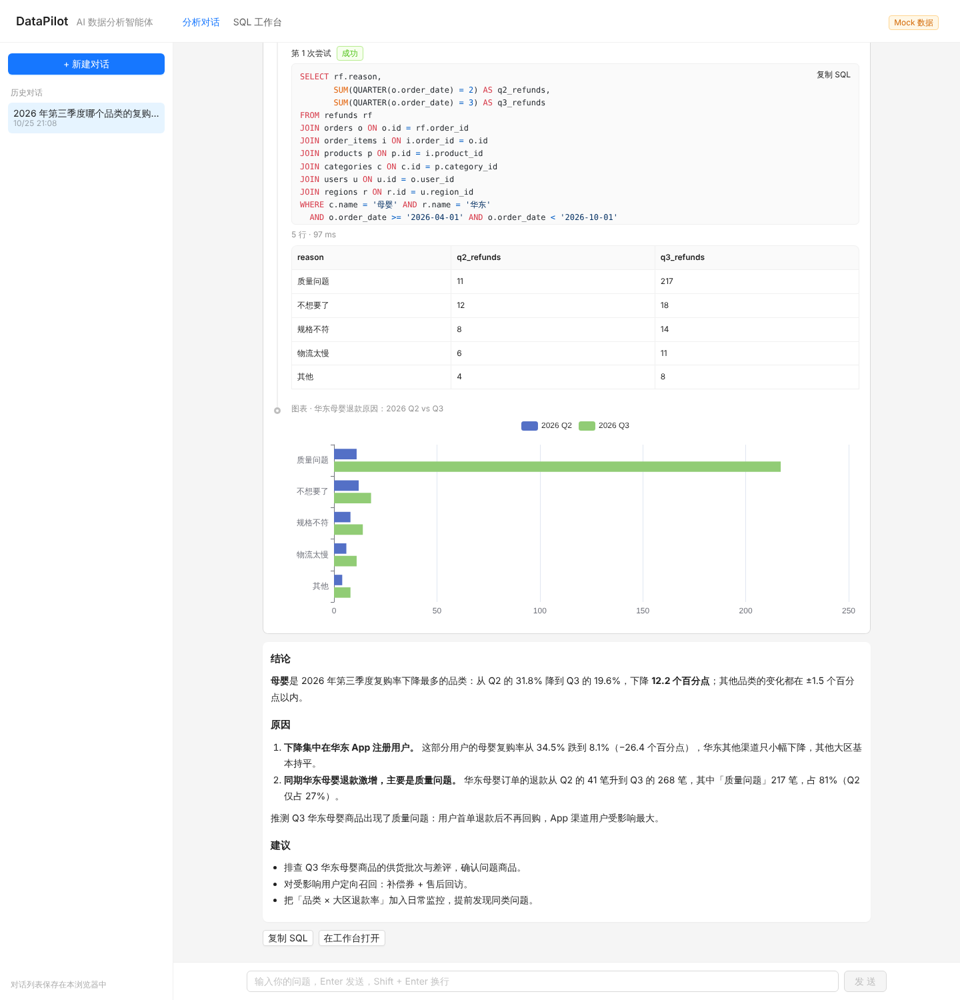
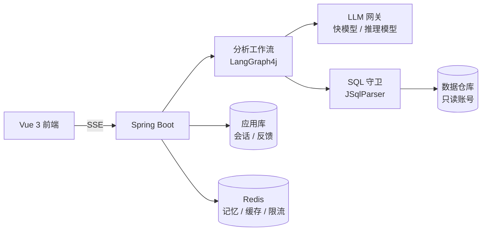

# DataPilot

**能自我纠错、会主动下钻的 AI 数据分析智能体。**

用自然语言向数据库提问，DataPilot 会自己查表结构、写 SQL、执行；SQL 出错时根据报错修正，结论不够时继续按维度下钻，最后给出图表和分析结论。整个过程实时可见，每一条执行过的 SQL 都可以核对。



> 🚧 项目处于早期开发阶段，下方 [路线图](#路线图) 标出了已完成和计划中的部分。

## 为什么不只是 Text-to-SQL

一句话转一条 SQL 很容易，在真实业务里可靠地回答问题很难：

| 问题 | DataPilot 的做法 |
|---|---|
| 表太多，模型不知道该查哪张 | 基于表与字段注释检索相关表，只把需要的结构交给模型 |
| 业务口径因公司而异（什么算“活跃用户”？） | 指标库：显式维护指标定义，模型按定义计算 |
| SQL 能跑通但算错了，比报错更危险 | 展示每一步执行的 SQL，结果合理性校验，评测集量化准确率 |
| 生成的 SQL 可能破坏数据或拖垮数据库 | 多层防护：SQL 语法树校验 + 只读账号 + 查询超时 + 行数上限 |
| “为什么下降？”一条 SQL 回答不了 | LangGraph4j 工作流驱动多步分析，按维度并行下钻 |

## 架构



## 快速开始

需要 Docker、JDK 17+、Node.js 22+。

```bash
docker compose up -d
```

启动 MySQL（宿主机端口 3307）和 Redis（6380），并自动导入示例电商库 `demo_shop`。

```bash
cd backend && LLM_API_KEY=你的key ./mvnw spring-boot:run
```

后端运行在 8080 端口。默认使用 DeepSeek，任何 OpenAI 兼容接口都可以通过 `LLM_BASE_URL`、`LLM_FAST_MODEL`、`LLM_REASONING_MODEL` 切换。

```bash
cd frontend && npm install && npm run dev
```

打开 http://localhost:5173。没有启动后端时，可以用 `npm run dev:mock` 回放一段预置的分析过程来体验界面。

## 示例数据集

`demo_shop` 是一个确定性生成的电商库（2 万用户、约 18 万订单，时间跨度 2024-06 至 2026-09），包含用户、商品、订单、退款等 8 张表，字段都带中文注释。

数据里**预埋了一个真实感的业务问题**，可以用来检验智能体能否完成“发现 → 下钻 → 归因”的完整分析。试试问它：

> 2026 年第三季度哪个品类的复购率下降最多？为什么？

生成脚本见 [`docker/mysql/init/03-demo-shop-data.sql`](docker/mysql/init/03-demo-shop-data.sql)（含答案，想自己先探索的话可以晚点看）。

## 项目结构

```
backend/    Spring Boot 4 后端
  guard/      SQL 安全守卫
  warehouse/  只读数仓访问、表结构读取
  llm/        模型配置（快模型 / 推理模型分层）
frontend/   Vue 3 + Ant Design Vue 前端
docker/     示例数据库初始化脚本
```

## 路线图

- [x] 只读数仓访问与表结构读取
- [x] SQL 安全守卫：仅允许单条 SELECT、拦截危险函数与系统库、自动限制行数
- [x] 示例电商数据集（含预埋业务问题）
- [x] SQL 工作台（表结构浏览、执行查询）
- [ ] 分析智能体：表检索 → 生成 SQL → 执行 → 报错自我纠错
- [ ] 多步下钻与归因分析
- [ ] 图表生成与分析结论，SSE 实时展示推理过程
- [ ] 多轮对话记忆
- [ ] BIRD Mini-Dev 评测与消融实验
- [ ] 指标库
- [ ] 主动洞察：定时巡检指标、异常检测、自动归因日报
- [ ] 反馈学习：用户确认的问答对存入向量库，作为相似问题的示例
- [ ] MCP Server

## 技术栈

Spring Boot 4 · LangChain4j · LangGraph4j · JSqlParser · MySQL · Redis · Flyway · Vue 3 · Ant Design Vue · ECharts
