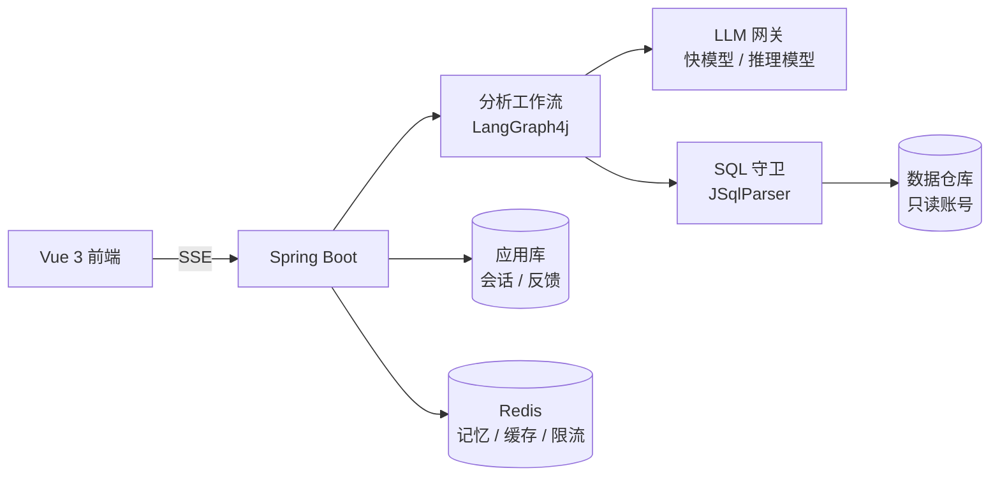
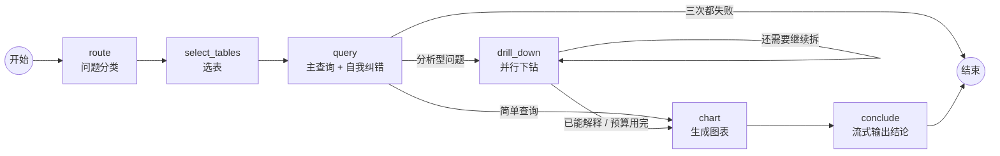

# DataPilot

**能自我纠错、会主动下钻的 AI 数据分析智能体。**

用自然语言向数据库提问，DataPilot 会自己查表结构、写 SQL、执行；SQL 出错时根据报错修正，结论不够时继续按维度下钻，最后给出图表和分析结论。整个过程实时可见，每一条执行过的 SQL 都可以核对。

> 🚧 项目处于早期开发阶段，下方 [路线图](#路线图) 标出了已完成和计划中的部分。

## 为什么不只是 Text-to-SQL

一句话转一条 SQL 很容易，在真实业务里可靠地回答问题很难：

| 问题 | DataPilot 的做法 |
|---|---|
| 表太多，模型不知道该查哪张 | 基于表与字段注释检索相关表，只把需要的结构交给模型 |
| 业务口径因公司而异（什么算“活跃用户”？） | 指标库：显式维护指标定义，模型按定义计算 |
| SQL 能跑通但算错了，比报错更危险 | 展示每一步执行的 SQL，结果合理性校验，评测集量化准确率 |
| 生成的 SQL 可能破坏数据或拖垮数据库 | 多层防护：SQL 语法树校验 + 只读账号 + 查询超时 + 行数上限 |
| “为什么下降？”一条 SQL 回答不了 | LangGraph4j 工作流驱动多步分析，按维度并行下钻 |

## 架构



## 快速开始

需要 Docker、JDK 17+、Node.js 22+。

```bash
docker compose up -d
```

启动 MySQL（宿主机端口 3307）和 Redis（6380），并自动导入示例电商库 `demo_shop`。

```bash
cd backend && LLM_API_KEY=你的key ./mvnw spring-boot:run
```

后端运行在 8080 端口。默认使用 DeepSeek，任何 OpenAI 兼容接口都可以通过 `LLM_BASE_URL`、`LLM_FAST_MODEL`、`LLM_REASONING_MODEL` 切换。

```bash
cd frontend && npm install && npm run dev
```

打开 http://localhost:5173。

## 工作原理

一次提问就是一次 [LangGraph4j](https://github.com/langgraph4j/langgraph4j) 状态图的执行，每个节点是 `backend/.../agent/node/` 下的一个类，节点之间只通过图状态（问题、选中的表、每一步的查询结果）传递数据：



| 节点 | 做什么 | 模型 |
|---|---|---|
| `route` | 判断是简单查询（“上月多少单”）还是分析型问题（为什么 / 对比 / 趋势），决定后面走多少步、用哪个模型 | 快模型 |
| `select_tables` | 根据表名、字段名和中文注释挑出需要的表（表结构缓存在 Caffeine 里，5 分钟过期），只把这些表的 DDL 交给后面的 SQL 生成 | 快模型 |
| `query` | 生成 SQL → SQL 守卫校验 → 只读执行。守卫拒绝或数据库报错时，把 SQL 和报错一起喂回模型重写，最多 3 次。这条 SQL 就是 `done.finalSql` | 简单：快模型；分析：推理模型 |
| `drill_down` | 分析型问题才走：模型看已有结果，提出最多 3 个拆分维度（大区、渠道、注册年份、退款原因……），这些查询在有界线程池里并行执行，每个都带同样的自我纠错。可以按发现继续往下拆，最多 2 轮，整次提问的查询总数不超过 6 | 推理模型 |
| `chart` | 模型只负责设计 ECharts 图（类型、坐标轴、`encode` 列映射），数据由代码从真实查询结果注入 `dataset`，图上的数字不可能是模型编的 | 快模型 |
| `conclude` | 基于所有结果流式写 Markdown 结论，逐段以 `token` 事件推给前端 | 同 `query` |

几个设计取舍：

- **流式事件**：每个节点边执行边通过 SSE 推送事件（`plan` / `tables` / `sql` / `sql_error` / `result` / `chart` / `token`），协议见 [`docs/analysis-api.md`](docs/analysis-api.md)。`done` / `error` 只由图外层发出，所以无论哪个节点出错、客户端断开还是超时，事件流都恰好以一个 `done` 或 `error` 结束。客户端断开后，智能体在下一次调用模型或执行 SQL 前停止，不再消耗 token。
- **成本控制**：单次提问的 SQL 尝试次数、总查询数、下钻轮数、并发分析数都有上限（`datapilot.agent.*`），超过并发上限直接返回 503 而不是排队。
- **多轮对话**：每轮的问题、结论和完整事件轨迹存入 `conversation_message`；继续对话时，最近 3 轮的问题、SQL 和结论摘要会进入 SQL 生成的提示词，所以“那华南呢？”可以直接复用上一轮的 SQL。
- **多数据库**：请求里的 `database` 必须在 `datapilot.warehouse.allowed-schemas`（环境变量 `WAREHOUSE_ALLOWED_SCHEMAS`，逗号分隔）中，`WarehouseClient` 自己也会校验，任何调用方都绕不过去。评测用的 BIRD 数据库作为同一 MySQL 上的独立 schema 加载，只读账号需要对它们有 SELECT 权限。
- **提示词**：全部在 [`backend/src/main/resources/prompts/`](backend/src/main/resources/prompts)，与代码分离，方便单独审阅和迭代。

## 示例数据集

`demo_shop` 是一个确定性生成的电商库（2 万用户、约 18 万订单，时间跨度 2024-06 至 2026-09），包含用户、商品、订单、退款等 8 张表，字段都带中文注释。

数据里**预埋了一个真实感的业务问题**，可以用来检验智能体能否完成“发现 → 下钻 → 归因”的完整分析。试试问它：

> 2026 年第三季度哪个品类的复购率下降最多？为什么？

生成脚本见 [`docker/mysql/init/03-demo-shop-data.sql`](docker/mysql/init/03-demo-shop-data.sql)（含答案，想自己先探索的话可以晚点看）。

## 项目结构

```
backend/    Spring Boot 4 后端
  agent/      分析智能体：状态图、各节点、SSE 推送
  conversation/ 会话与消息存储
  guard/      SQL 安全守卫
  warehouse/  只读数仓访问、表结构读取与缓存
  llm/        模型配置（快模型 / 推理模型分层）
  resources/prompts/ 提示词模板
frontend/   Vue 3 + Ant Design Vue 前端
docker/     示例数据库初始化脚本
```

## 路线图

- [x] 只读数仓访问与表结构读取
- [x] SQL 安全守卫：仅允许单条 SELECT、拦截危险函数与系统库、自动限制行数
- [x] 示例电商数据集（含预埋业务问题）
- [x] SQL 工作台（表结构浏览、执行查询）
- [x] 分析智能体：表检索 → 生成 SQL → 执行 → 报错自我纠错
- [x] 多步下钻与归因分析
- [x] 图表生成与分析结论，SSE 实时展示推理过程
- [x] 多轮对话记忆
- [ ] BIRD Mini-Dev 评测与消融实验
- [ ] 指标库
- [ ] 主动洞察：定时巡检指标、异常检测、自动归因日报
- [ ] 反馈学习：用户确认的问答对存入向量库，作为相似问题的示例
- [ ] MCP Server

## 技术栈

Spring Boot 4 · LangChain4j · LangGraph4j · JSqlParser · MySQL · Redis · Flyway · Vue 3 · Ant Design Vue · ECharts
